# Spaced Repetition Vocabulary Trainer — End-to-End Project Flow

> **Audience:** Technical Recruiters, Hiring Managers, and Senior Engineering Evaluators.  
> **Summary:** This document provides a complete walkthrough of the architecture, data flow, algorithm mechanics, and user journey of the Spaced Repetition Vocabulary Trainer application.

---

## 1. Executive Architecture Overview

The system is built as a **5-tier decoupled full-stack architecture** designed for production readiness, predictability, and high maintainability:

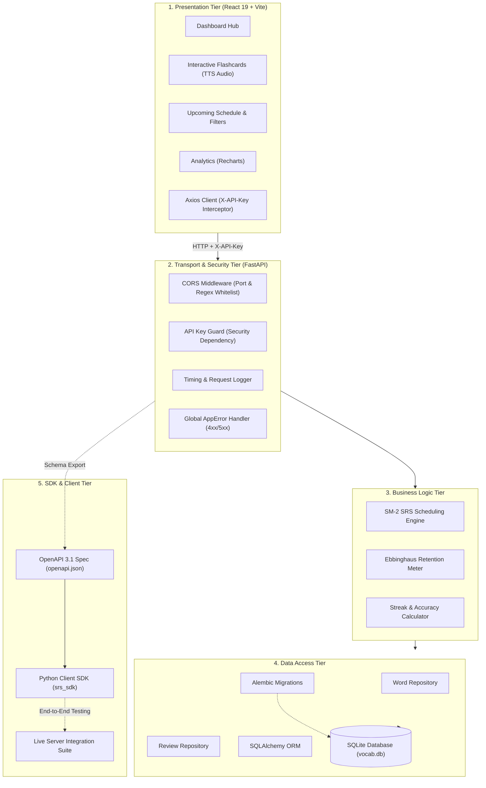

---

## 2. UML Use Case Diagram

This diagram visualizes how the different actors (Language Learner, Python SDK Developer, and System Poller) interact with the functional capabilities of the system.

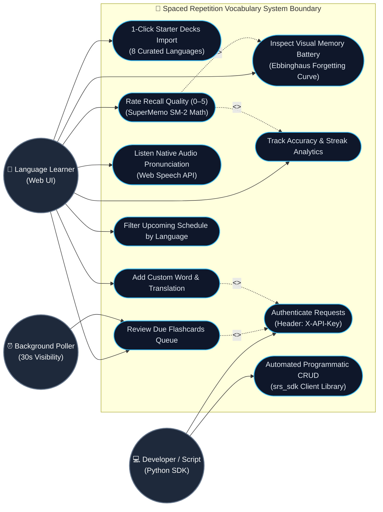

---

## 3. Flashcard Active Recall Interactive Flow Diagram

This activity flow illustrates the complete decision tree during an active learning session: from card presentation, audio pronunciation, user recall evaluation, SM-2 branch computation, database persistence, to memory battery updates.

```mermaid
flowchart TD
    StartSession([User Starts Review Session]) --> FetchDue[/GET /words/due/ with X-API-Key/]
    FetchDue --> CheckEmpty{Are cards due?}
    CheckEmpty -- No --> AllDone[Display 'All Caught Up!' Celebration Screen]
    CheckEmpty -- Yes --> LoadCard[Present Top Flashcard in Queue]

    LoadCard --> CardStateFront[Card Front: Displays Word & Target Language]
    CardStateFront --> AudioChoice{User clicks Speaker or presses 'P'?}
    AudioChoice -- Yes --> PlayTTS[Web Speech API: Play Pronunciation with Locale Tag]
    PlayTTS --> CardStateFront
    AudioChoice -- No --> FlipAction[User presses Space or clicks 'Flip Card']

    FlipAction --> CardStateBack[Card Back: Reveals Native Translation & 0-5 Scoring Scale]
    CardStateBack --> ScoreSelection{User Rates Recall Quality}

    ScoreSelection -- "Score 0-2 (Failed Recall)" --> SM2_Fail["Reset Repetition = 0<br/>Interval = 1 Day (Due Today)<br/>Decrease EF by up to -0.80"]
    ScoreSelection -- "Score 3-4 (Hesitant / Good)" --> SM2_Good["Repetition += 1<br/>1st Review: Interval = 2 Days<br/>Later: Interval = max(prev+1, round(prev * 1.2))<br/>Slight EF adjustment"]
    ScoreSelection -- "Score 5 (Perfect Recall)" --> SM2_Perfect["Repetition += 1<br/>1st Review: Interval = 5 Days<br/>Later: Interval = round(prev * EF)<br/>Increase EF (+0.10)"]

    SM2_Fail --> PersistTx[/POST /words/{id}/review/ to Backend/]
    SM2_Good --> PersistTx
    SM2_Perfect --> PersistTx

    PersistTx --> DBWrite[(Atomic DB Transaction:<br/>Insert Review Log + Update Word Schedule)]
    DBWrite --> UpdateUI[Recalculate Ebbinghaus Memory Battery & Streak]
    UpdateUI --> PopCard[Remove Card from Active Due Queue]
    PopCard --> CheckMore{Remaining cards in queue?}
    CheckMore -- Yes --> LoadCard
    CheckMore -- No --> AllDone
```

---

## 4. Level-1 Data Flow Diagram (DFD Level 1)

This diagram documents the movement of data between external actors, processing entities, and persistent data stores.

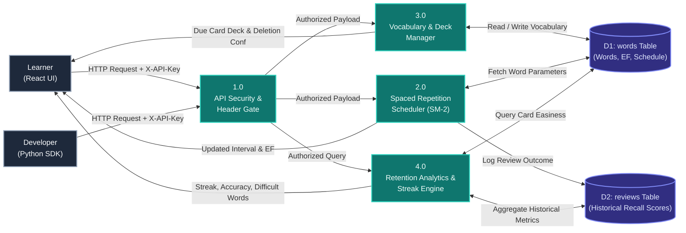

---

## 5. End-to-End User Journey Sequence Flow

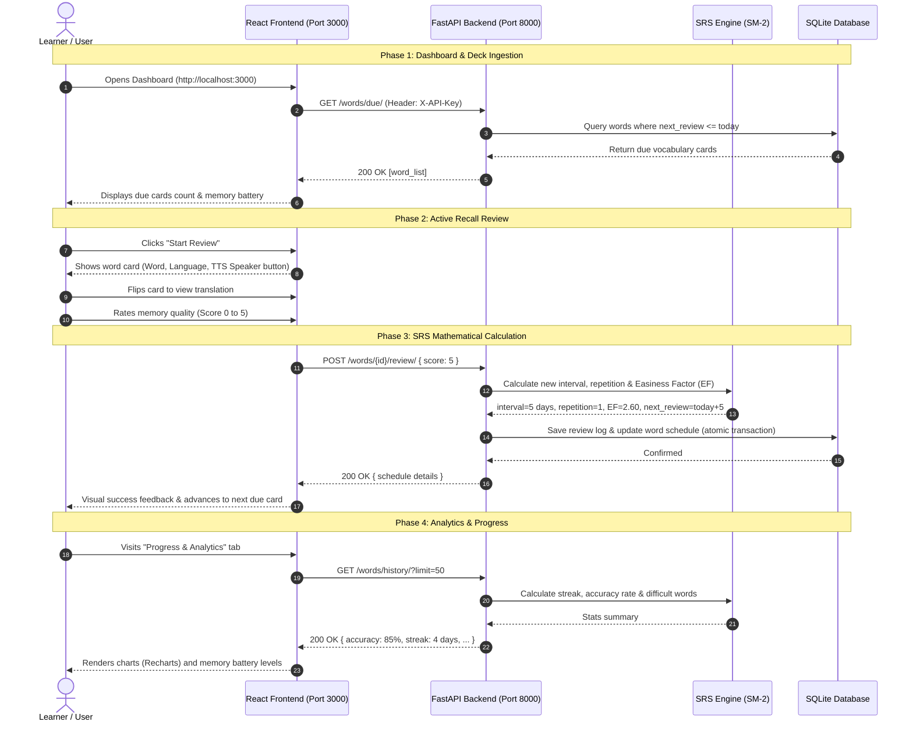

---

## 6. The Spaced Repetition (SRS) Engine Lifecycle & Decision Tree

The core algorithm is based on SuperMemo (SM-2) with optimized initial review intervals and deterministic interval calculations:

### 6.1 SRS Mathematical Decision Tree Diagram

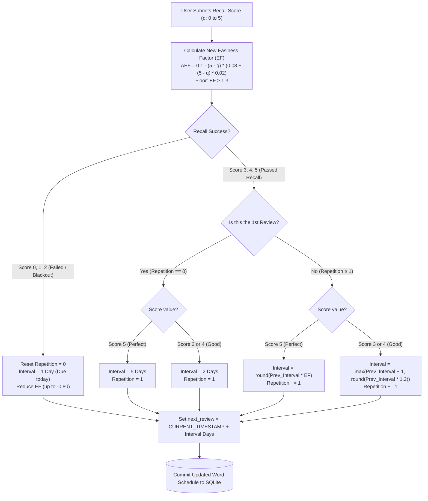

### 6.2 Visual Memory Battery (Ebbinghaus Forgetting Curve)

The frontend visualizes neural stability and memory decay dynamically:

```mermaid
stateDiagram-v2
    [*] --> Peak: Card reviewed with Score 4-5
    Peak: 🔋 Peak Retention (85%–100%)\nNewly reinforced; high stability\nVisual: Emerald Green Gauge
    Solid: 🔋 Solid Memory (65%–84%)\nRetained firmly; low decay\nVisual: Cyan / Teal Gauge
    Fading: 🪫 Fading Recall (35%–64%)\nApproaching forgetting threshold\nVisual: Amber / Orange Gauge
    Critical: 🪫 Critical Decay (<35%)\nMemory threshold reached; DUE NOW!\nVisual: Crimson Red Pulse

    Peak --> Solid: Time passes (t / S)
    Solid --> Fading: Time passes (t / S)
    Fading --> Critical: Interval reached (t ≥ Interval)
    Critical --> Peak: Reviewed with Score 4 or 5
    Critical --> Critical: Reviewed with Score 0 to 2 (due reset)
```

---

## 7. Security & Authentication Flow

To meet production software standards, access control is enforced via custom HTTP headers:

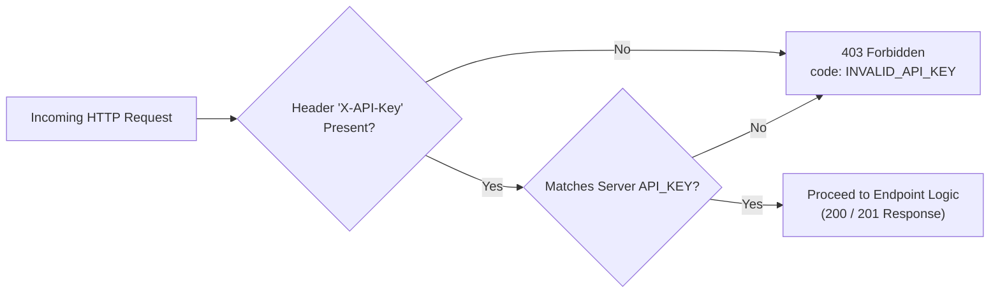

- **Protected Routes:** All data mutations and spaced repetition endpoints under `/words/*`.
- **Public Routes:** `/` (System health and welcome payload), `/docs` (Interactive Swagger portal), and `/openapi.json`.
- **Zero-Friction Local Testing:** The frontend Axios client and Python SDK automatically inject the development key (`srs-dev-secret-key-2026`) with `.env` override capability.

---

## 8. Python SDK & Integration Pipeline Flow

Beyond the REST API, the project maintains an automated client SDK generation lifecycle:

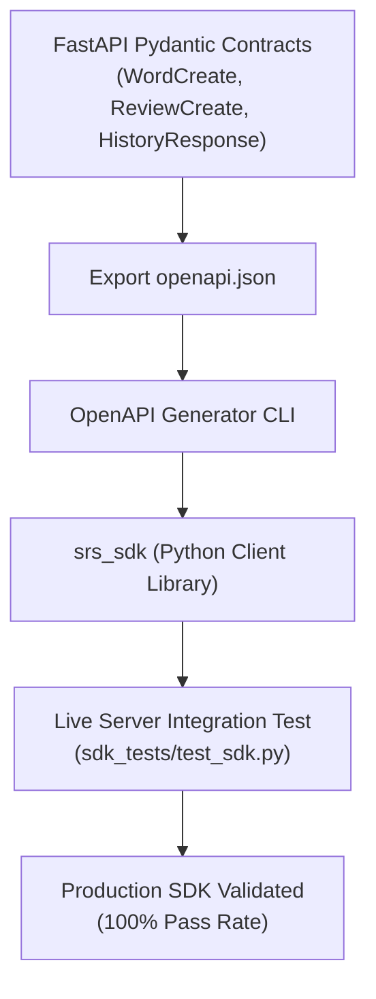

Developers can interact with the system cleanly in Python:
```python
import os
from srs_sdk.configuration import Configuration
from srs_sdk.api_client import ApiClient
from srs_sdk.api.words_api import WordsApi

# Automatically authenticated via custom header
config = Configuration(host="http://localhost:8000")
with ApiClient(config, header_name="X-API-Key", header_value=os.getenv("API_KEY", "srs-dev-secret-key-2026")) as client:
    words_api = WordsApi(client)
    due_cards = words_api.get_due_words()
    print(f"Due flashcards count: {len(due_cards)}")
```

---

## 9. Frontend Component Architecture & Navigation Map

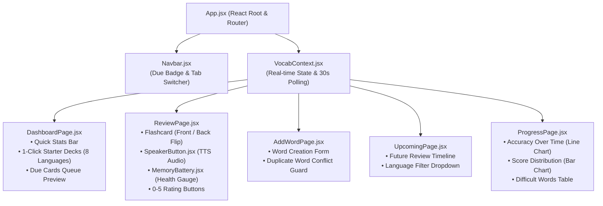

---

## 10. Database Entity-Relationship (ER) & Cascading Diagram

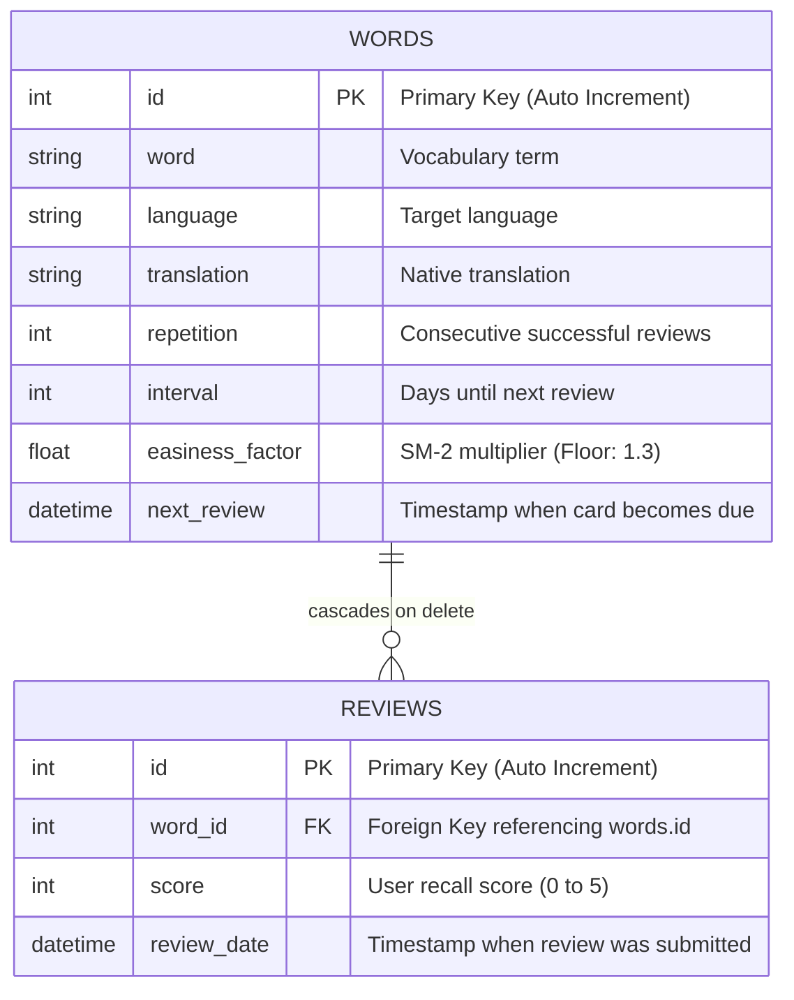

---

## 11. 1-Click Startup Lifecycle Flowchart

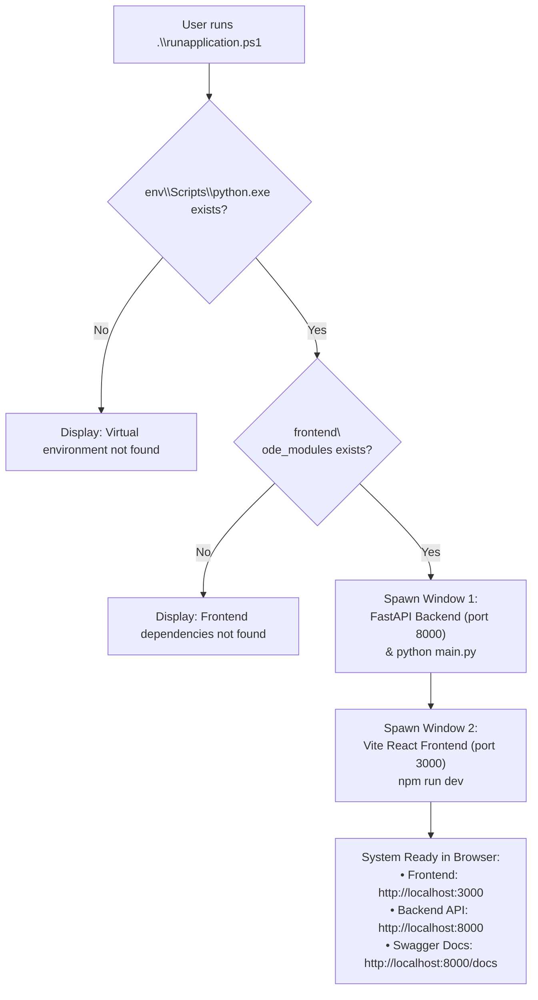

---

## 12. How to Run the Project (Quick Reference)

### 1-Click Startup (PowerShell)
```powershell
.\runapplication.ps1
```
*(Or in classic Command Prompt: `runapplication.bat`)*

### Service Endpoints
- **Frontend Web Application:** [http://localhost:3000](http://localhost:3000)
- **FastAPI REST Server:** [http://localhost:8000](http://localhost:8000)
- **Interactive Swagger Documentation:** [http://localhost:8000/docs](http://localhost:8000/docs)

### Verification Commands
```powershell
# Run the complete test suite (26 tests including security):
.\env\Scripts\python.exe -m pytest tests/ sdk_tests/

# Run the standalone Python SDK demo:
.\env\Scripts\python.exe examples\sdk_demo.py
```

