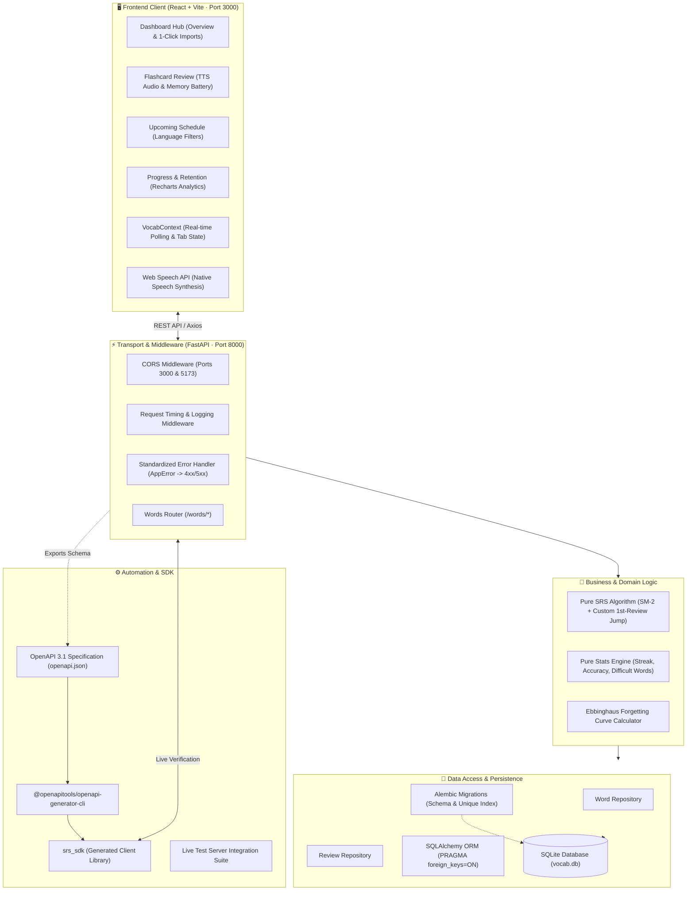
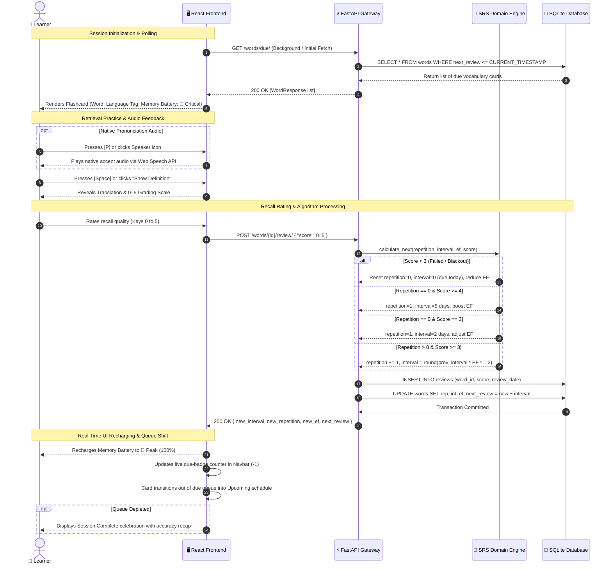
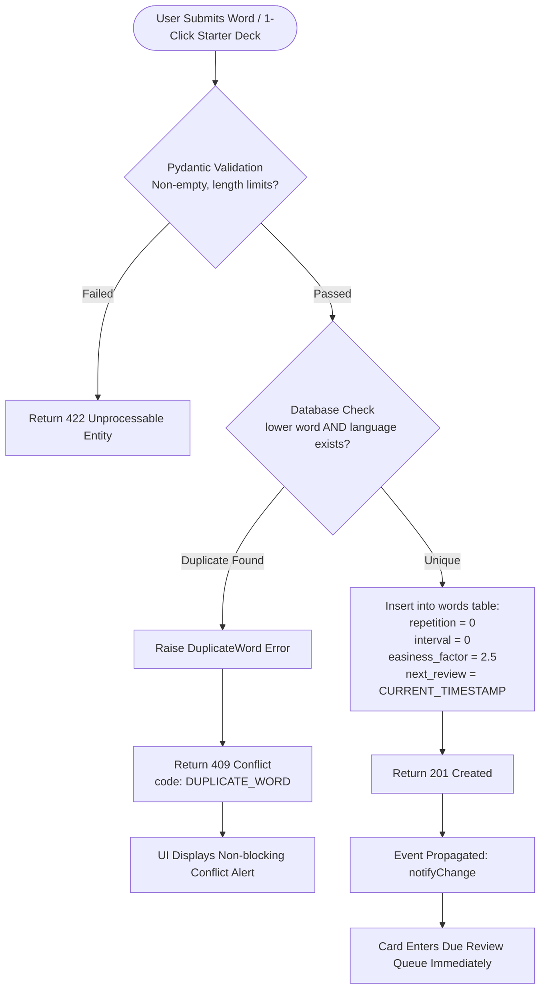
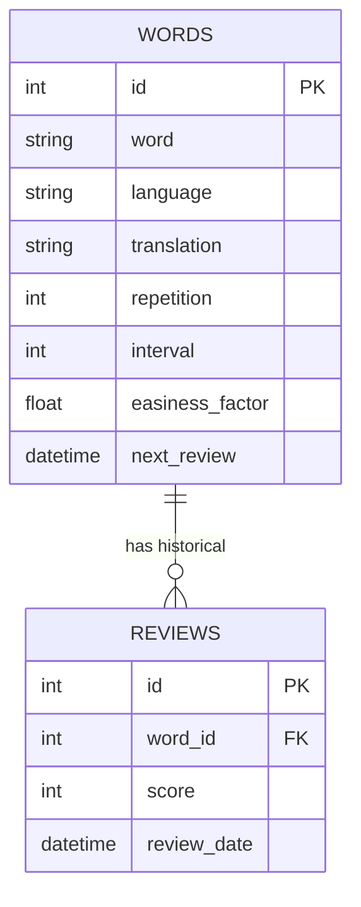

# Spaced Repetition Vocabulary Trainer (SRS)

An enterprise-grade, full-stack Spaced Repetition System (SRS) designed for high-efficiency human vocabulary retention. Built with **FastAPI**, **SQLite**, **Alembic**, **React (Vite)**, and an automated **Python SDK** generator pipeline.

---

## 1. System Architecture Overview

The system uses a strictly decoupled, 5-tier layered architecture ensuring separation of concerns between presentation, transport, business rules, persistence, and automated code generation.

### High-Level System Architecture Diagram



---

## 2. End-to-End Process Flow Diagrams

### 2.1 Spaced Repetition Review Lifecycle (Sequence Flow)

This diagram illustrates the complete interactive review sequence, from due card fetching, native TTS pronunciation, recall evaluation, algorithm branching, database persistence, to real-time UI state synchronization.



### 2.2 Word Addition & Duplicate Conflict Flow



---

## 3. Layered Architecture Breakdown

### 3.1 Presentation Layer (`frontend/src/`)
- **Technology Stack**: React 19, Vite, Vanilla CSS Design System, Recharts, Lucide Icons.
- **State & Lifecycle Management** (`VocabContext.jsx`):
  - Emits real-time updates across components.
  - **30-second interval polling** for due flashcards.
  - **Page Visibility API listener**: Automatically pauses polling when the browser tab is hidden (`document.visibilityState === 'hidden'`) to conserve client/server resources, resuming immediately when active.
- **Zero-Dependency Pronunciation** (`speech.js`):
  - Employs native browser `window.speechSynthesis` with BCP-47 locale tags (`es-ES`, `fr-FR`, `de-DE`, `ja-JP`, `it-IT`, `ru-RU`, `zh-CN`, `en-US`).
  - Tuned learner speech rate (`0.88x`) for phonetic clarity.
- **Visual Memory Battery** (`retentionMeter.js`):
  - Visualizes real-time Ebbinghaus memory decay: Peak (85–100%), Solid (65–84%), Fading (35–64%), Critical (<35%).

### 3.2 Transport & API Gateway Layer (`app/api.py`, `app/routers/`)
- **Dependency Injection**: Every route injects database sessions via `Depends(get_db)`.
- **Global Error Normalization**:
  All client errors return an immutable, consistent JSON shape:
  ```json
  {
    "detail": "Descriptive human-readable explanation",
    "code": "ERROR_CODE_IDENTIFIER"
  }
  ```
- **Logging Middleware**: Logs incoming HTTP method, URL path, response status, and processing duration in milliseconds.

### 3.3 Domain Service Layer (`app/services/`)
- **Pure Functions**: `srs.py` and `stats_service.py` contain zero side-effects and zero database imports, enabling instantaneous deterministic unit testing.
- **SM-2 SRS Algorithm**: Calculates next repetition, interval in days, and updated easiness factor based on recall feedback (scores 0–5).

### 3.4 Data Access & Persistence Layer (`app/repositories/`, `app/db/`)
- **Repository Pattern**: `WordRepository` and `ReviewRepository` encapsulate raw SQLAlchemy queries away from route handlers.
- **SQLite Engine Configuration**:
  - Enforces `PRAGMA foreign_keys=ON` via SQLAlchemy event listener on connect.
  - Case-insensitive unique compound index: `UNIQUE INDEX ix_words_lower_word_language ON words (lower(word), language)`.
  - Cascading deletes: Deleting a word instantly cascades and cleans up all historical review records.

---

## 4. Database Schema & ER Diagram



### Alembic Migration Lineage
1. **Migration 1 (`7801cf05051a_create_words_and_reviews_tables`)**: Creates `words` and `reviews` tables with constraints (`score >= 0 AND score <= 5`).
2. **Migration 2 (`a1b2c3d4e5f6_add_unique_index_lower_word_language`)**: Creates raw SQLite functional index `ix_words_lower_word_language ON words (lower(word), language)`.

---

## 5. Spaced Repetition (SRS) Algorithm & Mathematics

### 5.1 Easiness Factor (EF) Formula
The Easiness Factor represents card difficulty (baseline `2.5`, floor `1.3`):
$$\Delta EF = 0.1 - (5 - \text{score}) \times (0.08 + (5 - \text{score}) \times 0.02)$$
$$EF_{\text{new}} = \max(1.3, EF_{\text{old}} + \Delta EF)$$

### 5.2 Interval Scheduling Rules

| Condition | Action / Formula |
|---|---|
| **Score < 3 (Failed / Blackout)** | Reset `repetition = 0`, reset `interval = 0` (due immediately today). Reduce EF. |
| **First Review (Repetition == 0)** | • If $\text{score} \ge 4$: interval = **5 days**<br>• If $\text{score} = 3$: interval = **2 days**<br>• `repetition = 1`. |
| **Later Reviews (Repetition > 0)** | • $\text{interval} = \text{round}(\text{previous\_interval} \times EF_{\text{new}} \times 1.2)$<br>• Increment `repetition` by 1. |

### 5.3 Ebbinghaus Memory Retention Decay Model
$$R(t) = e^{-t / S}$$
- **Peak Health (🔋 85%–100%)**: Newly reinforced; high neural stability.
- **Solid Health (🔋 65%–84%)**: Retained firmly within optimal interval.
- **Fading Health (🪫 35%–64%)**: Approaching the scheduled review window.
- **Critical Decayed (🪫 10%–34%)**: Card is due or overdue; requires immediate review.

---

## 6. API Reference & Specification

All endpoints are tagged under `words` with explicit `operation_id` for client generation.

| Method | Endpoint | Summary | Status Codes |
|---|---|---|---|
| `POST` | `/words/` | Add vocabulary word | `201 Created`, `409 Conflict`, `422 Unprocessable` |
| `GET` | `/words/due/` | Fetch flashcards currently due | `200 OK` |
| `POST` | `/words/{id}/review/` | Submit recall score (0–5) | `200 OK`, `404 Not Found`, `422 Unprocessable` |
| `GET` | `/words/upcoming/` | Paginated future schedule | `200 OK` |
| `GET` | `/words/history/` | Accuracy, streak, difficult words | `200 OK` |
| `DELETE` | `/words/{id}` | Delete card & cascade reviews | `204 No Content`, `404 Not Found` |

---

## 7. Project Directory Map

```text
vocab-trainer/
├── app/
│   ├── core/                  # Settings, config, logging, and error classes
│   │   ├── config.py          # CORS origins and database URL
│   │   ├── errors.py          # AppError, WordNotFound, DuplicateWord
│   │   └── logging.py         # Request logging middleware
│   ├── db/                    # Database models and session engine
│   │   ├── database.py        # SQLAlchemy engine and PRAGMA event listener
│   │   └── models.py          # Word and Review SQLAlchemy models
│   ├── repositories/          # Data access abstraction
│   │   ├── word_repo.py       # Words queries, due, upcoming, lower index checks
│   │   └── review_repo.py     # Reviews queries and pagination
│   ├── routers/               # HTTP route controllers
│   │   └── words.py           # /words/* REST endpoints
│   ├── schemas/               # Pydantic v2 validation contracts
│   │   ├── word.py            # WordCreate, WordResponse
│   │   ├── review.py          # ReviewCreate, ReviewScheduleResponse
│   │   └── history.py         # HistoryResponse
│   ├── services/              # Pure business algorithms
│   │   ├── srs.py             # Pure SM-2 algorithm function
│   │   ├── stats_service.py   # Pure accuracy, streak, and difficulty calculations
│   │   └── word_service.py    # Service orchestrator
│   ├── api.py                 # FastAPI application factory
│   └── deps.py                # Database dependency injection
├── alembic/                   # Database migration lineage
├── frontend/                  # React Vite client
│   ├── src/
│   │   ├── components/        # Navbar, MemoryBattery, SpeakerButton
│   │   ├── context/           # VocabContext (real-time polling & visibility listener)
│   │   ├── data/              # Curated 1-click starter decks (8 languages)
│   │   ├── pages/             # DashboardPage, ReviewPage, AddWordPage, UpcomingPage, ProgressPage
│   │   ├── utils/             # speech.js (TTS engine), retentionMeter.js (Ebbinghaus curve)
│   │   ├── api.js             # Axios client with interceptors
│   │   ├── App.jsx            # React router definitions
│   │   └── index.css          # Design system & dark glassmorphic styling
│   └── vite.config.js         # Port 3000 Vite configuration
├── srs_sdk/                   # Auto-generated Python SDK package
├── sdk_tests/                 # Live server integration tests for SDK
├── examples/                  # Standalone SDK demonstration scripts
├── tests/                     # Backend test suite (pytest)
├── setupdev.bat               # Automated development setup script
├── runapplication.bat         # Concurrent multi-server launcher script
├── openapi.json               # Exported OpenAPI 3.1 specification
└── README.md                  # This architecture reference
```

---

## 8. Testing & Verification

The suite encompasses unit tests, repository tests, API integration tests, and live-server SDK verification.

```powershell
# Run full test suite with coverage report
$env:PYTHONPATH="."
.\env\Scripts\python -m pytest --cov=app --cov-report=term-missing
```

### Verified Test Coverage: **99%**
```text
=============================== tests coverage ================================
Name                              Stmts   Miss  Cover
-----------------------------------------------------
app\api.py                           23      1    96%
app\core\config.py                    5      0   100%
app\core\errors.py                   21      0   100%
app\core\logging.py                  17      0   100%
app\db\database.py                   13      0   100%
app\db\models.py                     23      0   100%
app\deps.py                           6      0   100%
app\repositories\review_repo.py      12      0   100%
app\repositories\word_repo.py        27      0   100%
app\routers\words.py                 30      0   100%
app\schemas\history.py                9      0   100%
app\schemas\review.py                15      0   100%
app\schemas\word.py                  16      0   100%
app\services\srs.py                  19      0   100%
app\services\stats_service.py        42      1    98%
app\services\word_service.py         35      0   100%
-----------------------------------------------------
TOTAL                               313      2    99%
======================== 40 passed in 1.09s ========================
```

---

## 9. Automated Setup & Execution

### One-Click Startup (Windows)
```cmd
runapplication.bat
```
- **Frontend Web Application**: [http://localhost:3000](http://localhost:3000)
- **FastAPI REST API**: [http://localhost:8000](http://localhost:8000)
- **Interactive Swagger Documentation**: [http://localhost:8000/docs](http://localhost:8000/docs)
